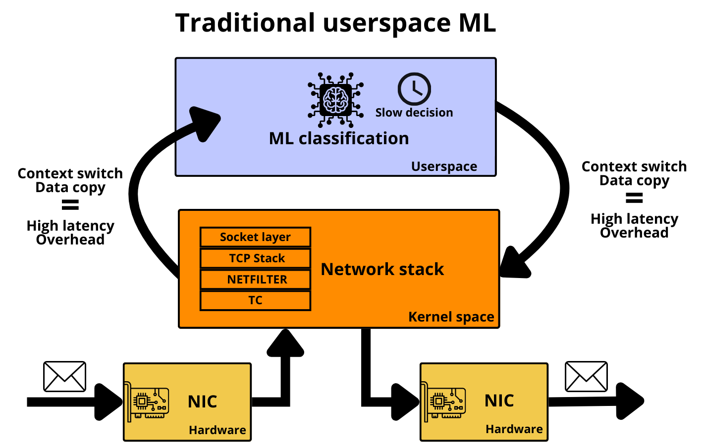
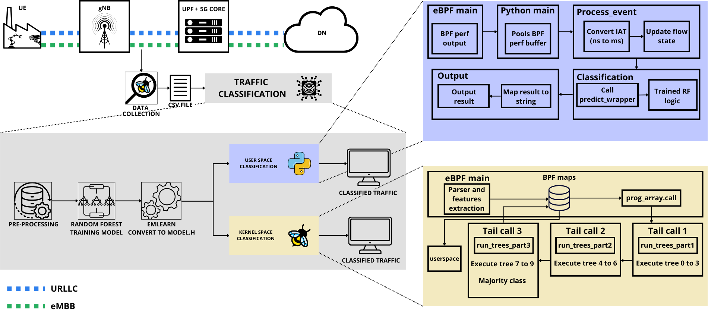

# Leveraging eBPF/XDP for Real-Time Machine Learning Traffic Classification in 5G User Plane Networks

This repository contains the source code and experimental artifacts related to the paper **“Leveraging eBPF/XDP for Real-Time Machine Learning Traffic Classification in 5G User Plane Networks.”**

The main objective of this work is to implement a **Random Forest traffic classifier inside a 5G User Plane Function (UPF)**, leveraging **eBPF/XDP** to enable traffic classification within a **privileged kernel space environment**, while proposing an alternative to traditional approaches that typically introduce high CPU overhead and increased latency due to repetitive context switching and data copying across the network stack.

The proposed solution supports traffic classification in **two execution environments: Kernel space and User space**

---

## Repository Structure

The repository is organized according to the classification environment:

- kernel_class/ # Kernel space traffic classification

- user_class/ # User space traffic classification

- data/ # Dataset used for training and evaluation

- urllc_redirect/ # Kernel space classification + URLLC forwarding via XDP_REDIRECT
  - Code/ # Modified eBPF/XDP classifier with class-based forwarding
  - Data/ # CSV files with the latency / processing time results

- Figures/ # Figures used in the paper

- README.md

Data file is available at  
**[google drive](https://drive.google.com/drive/folders/1Jc1otpAZwM6InJ8oTo0HxSSbh2Gsqw3o?usp=sharing)**

---

## Experimental Pipeline

The figure below illustrates the complete experimental pipeline, including traffic generation, data collection, model training, model conversion, and integration into both user space and kernel space environments.

Further implementation and evaluation details are provided in the paper.

---

## Requirements

- All `.py` and `.c` files belonging to the same scenario (**kernel space** or **user space**) must be located in the **same directory** when executed.
- The **BCC (BPF Compiler Collection)** library must be installed.

Installation instructions are available at:  
https://github.com/iovisor/bcc/blob/master/INSTALL.md

---

## Kernel Space Classification

The **kernel-space classifier** is implemented using eBPF/XDP and executes the Random Forest model within the kernel.

### Files

Located in the `kernel_class` directory:

- **`monitorjanela.py`**  
  User space control program responsible for:
  1. Compiling and loading the eBPF program into the kernel  
  2. Attaching the XDP program to the network interface  
  3. Populating the `PROG_ARRAY` used for tail calls  
  4. Reading events from the `perf_buffer` and formatting them for terminal output  

- **`monitorjanela.bpf.c`**  
  Kernel-space eBPF/XDP program responsible for:
  1. Decapsulating Ethernet, IP, UDP, and GTP-U headers to access the inner user IP address  
  2. Computing the mean and variance of the Inter-Arrival Time (IAT) within a 500 ms window  
  3. Executing the Random Forest decision trees using tail calls (`model500msJANELA.h`)  
  4. Sending classification results and metadata to user space  

- **`model500msJANELA.h`**  
  Header file generated by **[emlearn](https://github.com/emlearn/emlearn)**, containing the decision tree structures and prediction functions used by the kernel-space classifier.

---

## User Space Classification

In the **user space classifier**, eBPF/XDP is used only for metric collection, while classification is performed in user space via a shared C library.

### Files

Located in the `user_class` directory:

- **`monitor.py`**  
  User space control program responsible for:
  1. Compiling and loading the eBPF program into the kernel  
  2. Attaching the XDP program to the network interface  
  3. Receiving events via `perf_buffer`  
  4. Computing the mean and variance every 500 ms and invoking the classification library (`libclassifier.so`)  

- **`monitor.bpf.c`**  
  Kernel space eBPF/XDP program responsible for:
  1. Decapsulating Ethernet, IP, UDP, and GTP-U headers to access the inner user IP address  
  2. Computing the Inter-Arrival Time (IAT)  
  3. Sending metadata to user space  

  *In this scenario, the eBPF program acts solely as a data collector, forwarding metrics to user space for classification.*

- **`model500msJANELA.h`**  
  Header file generated by **emlearn**, containing the Random Forest decision tree structures.

- **`wrapper.c`**  
  Adaptation layer that enables the emlearn-generated C model to be executed directly from Python (`monitor.py`).

- **`libclassifier.so`**  
  Shared library compiled from `wrapper.c`, used for user-space classification.

---

## URLLC Prioritization via XDP_REDIRECT

The `urllc_redirect` directory extends the **kernel space classifier** so that the classification result is used to decide **how each packet is forwarded**:

- **URLLC (class 0)**: the packet is decapsulated directly in XDP (the GTP-U tunnel headers are removed with `bpf_xdp_adjust_head`), the Ethernet header is rewritten and the packet is sent straight out of the egress interface with `bpf_redirect`, **bypassing the kernel network stack**.
- **eMBB (class 1)**: the packet receives `XDP_PASS` and follows the normal kernel routing path.

To measure the benefit, the program also records the **total processing time** of each packet, from its arrival at the ingress interface (XDP) to its departure from the host (in the redirect itself for URLLC, or in a TC egress hook for eMBB).

### Code

Located in `urllc_redirect/Code`:

- **`monitorjanela.py`**  
  User space control program. In addition to the tasks of the original kernel space version, it:
  1. Registers the `prioritize_urllc` program in the `PROG_ARRAY` (index 4)  
  2. Fills the `redirect_cfg` map with the egress interface index, its source MAC and the destination MAC (resolved via ARP from `IP_DESTINO_URLLC`)  
  3. Attaches a pass-through XDP program to the egress interface (required for `bpf_redirect` to work on it)  
  4. Attaches a TC egress hook (`clsact`) to the egress interface to capture the departure time of eMBB packets  
  5. Correlates classification events and exit events (by outer IP source, destination and ID) and prints the processing time in the `PROC_US` column  

- **`monitorjanela.bpf.c`**  
  Kernel space eBPF program. Main changes compared to `kernel_class`:
  1. **Sticky class per flow**: the Random Forest is executed only when the 500 ms window closes, using the statistics of the completed window; the resulting class is applied to all packets of the flow until the next window closes (avoids URLLC/eMBB switching packet by packet, which causes TCP reordering and retransmissions). New flows start as eMBB.  
  2. **`prioritize_urllc`**: tail call that decapsulates and redirects URLLC packets.  
  3. **`tc_egress_capture`**: TC egress hook that computes the processing time of eMBB packets.  
  4. **`egress_xdp_enable`**: pass-through XDP program for the egress interface.  
  5. IP fragments are ignored (`XDP_PASS`).  

- **`model500msJANELA.h`**  
  Random Forest model generated by **emlearn**.

Before running, adjust the interfaces and destination IP in `monitorjanela.py` to your environment:

| Variable | Description |
|---|---|
| `interface_monitorada` | Ingress interface (GTP-U traffic), e.g. `enp9s0` |
| `INTERFACE_SAIDA_URLLC` | Egress interface for the redirected URLLC traffic and uplink of the eMBB traffic, e.g. `enp10s0` |
| `IP_DESTINO_URLLC` | Destination host of the redirected URLLC traffic (same L2 segment as the egress interface) |

The `pyroute2` Python library is also required (`pip install pyroute2`).

### Data

Located in `urllc_redirect/Data`, the CSV files (separator `;`) contain the per-packet results of the experiments:

- **`latencias_comum_8.csv`**
- **`latencias_por_pacote_4.csv`**

| Column | Description |
|---|---|
| `CLASS` | Class assigned to the packet (`URLLC` or `eMBB`) |
| `TIME_S` | Packet timestamp (Unix epoch, seconds) |
| `LATENCY_MS` | Packet latency (ms) |
| `INF_US` | Random Forest inference time (µs) |
| `PROC_US` | Total processing time in the host, from ingress to egress (µs) |

---

## Additional Information

For more details about the system architecture, model training, and performance evaluation, please refer to the associated paper.
